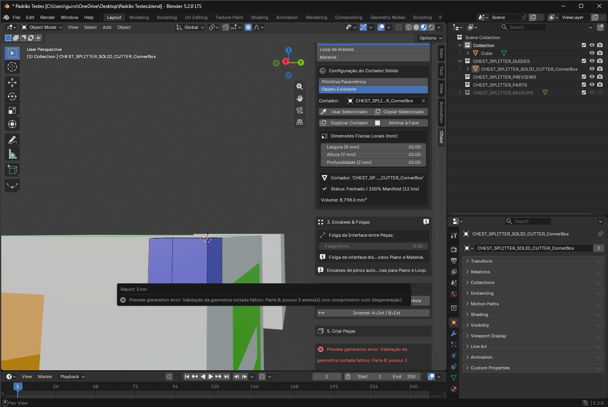
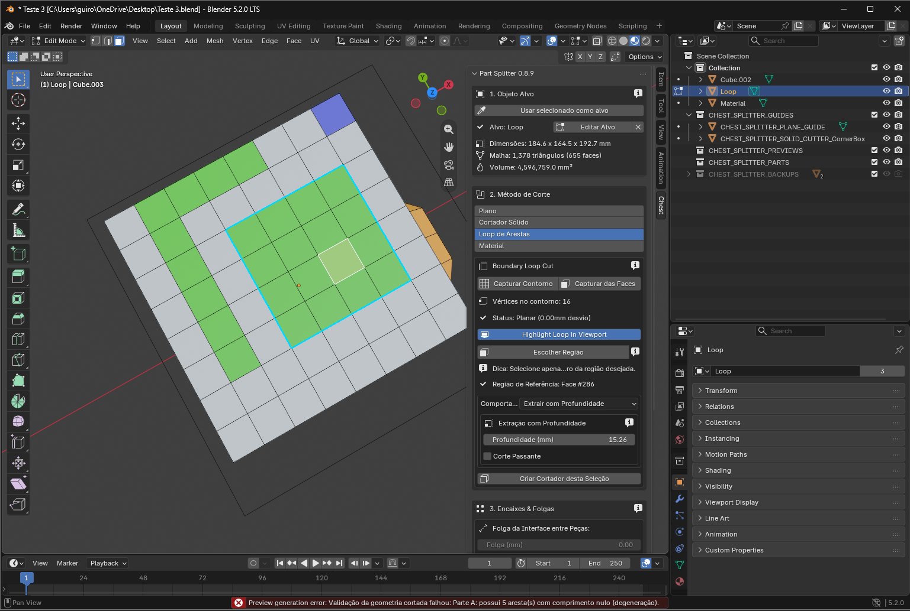
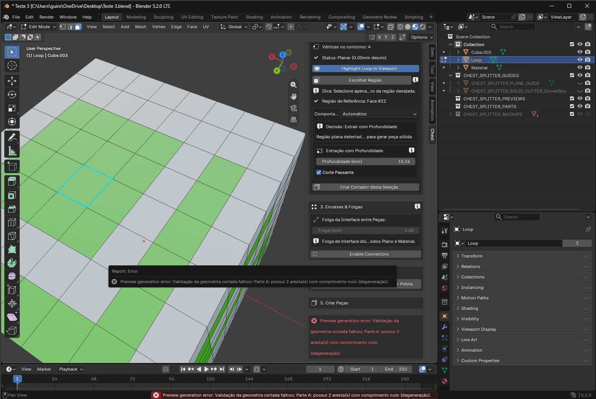
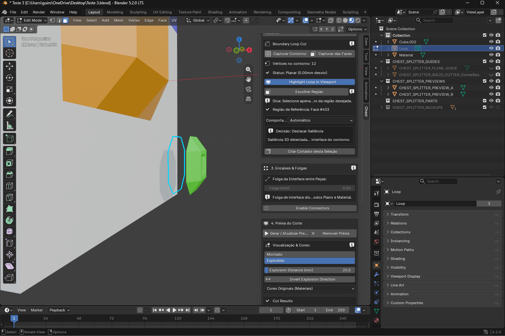
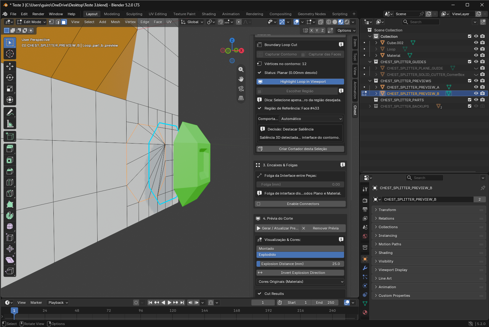
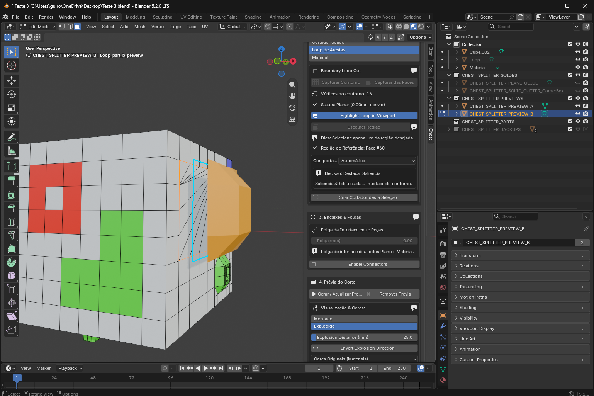

# Part Splitter — plano de desenvolvimento 0.8.10 (versão proposta)

Base: ZIP `chest_part_splitter-0.8.9.zip`. Data: 13/10/2026. Destino: Antigravity com o modelo chamado pelo usuário de Gemini Flash 3.8. Este documento não presume capacidades específicas desse nome de modelo. Execute em etapas pequenas, com evidência de teste a cada etapa.

## 1. Instrução inicial para o agente implementador

Leia este plano completo, `NOTAS_CODIGO.md` e o código da base antes de editar. Abra cópias de `casos/Teste_3.blend` e `casos/Teste_4.blend` no Blender. Registre o estado real deles: as capturas podem representar momentos posteriores ao salvamento dos arquivos. Não suponha que o arquivo contém exatamente a seleção da imagem.

Implemente primeiro a recuperação da extração por loop e os contratos quebrados de criação de cortador. Depois implemente alinhamento, base de saliência, triangulação, visualização e idioma. Não remova verificações de integridade para fazer uma prévia passar. Não altere medidas internas ou a silhueta sem controle explícito do usuário. Não remodele toda a extensão. Preserve restauração de previews/cortes, isolamento por sessão e materiais.

Antes de cada etapa: descreva o problema, funções atingidas e teste que vai falhar antes e passar depois. Ao terminar: informe arquivos alterados, resultados reais, limitações e pendências. Não declare teste executado com base somente em leitura, compilação Python ou screenshot. Se Blender não estiver disponível, registre a limitação e deixe a validação de execução pendente.

## 2. Evidência e limites desta análise

Foram lidos os módulos Python da 0.8.9 e as capturas fornecidas. Nesta análise não havia executável Blender nem módulo `bpy`; os `.blend` não foram abertos ou executados. Não está comprovado que coincidência de faces seja a causa das arestas quase nulas. Está comprovado no código que existem contratos incompatíveis, pressupostos incorretos de alinhamento e seleção conjunta na confirmação.

O manifesto exige Blender >= 4.2.0. As capturas mostram Blender 5.2.0 LTS. Validar ao menos 4.2 e 5.2 ou revisar explicitamente a compatibilidade declarada. Os ZIPs 0.8.5/0.8.6 são históricos; não implementar sobre eles. O pacote inclui a base 0.8.9 intacta e seus hashes.

| ID | Prioridade | Observação | Grau de certeza |
|---|---|---|---|
| DEV-01 | P0 | Extração por loop em região plana falha com 2 ou 5 arestas quase nulas em A | Falha observada; causa pendente |
| DEV-02 | P0 | Corte da quina falha com 3 arestas quase nulas em B | Falha observada; causa pendente |
| DEV-03 | P0 | Criar cortador da seleção chama funções com argumentos incompatíveis | Confirmado estaticamente |
| DEV-04 | P1 | Caixa de quina pode apontar um eixo para fora; falta validação de canto compartilhado | Confirmado no algoritmo; extensão do efeito a reproduzir |
| DEV-05 | P1 | Alinhar à face depende da origem central e dimensão mundial Z | Confirmado estaticamente |
| DEV-06 | P1 | Triangulação da tampa produz leque e triângulos estreitos | Observado; deformação física não comprovada |
| DEV-07 | P1 | Saliência termina com zonas muito finas; usuário quer base retirada do receptor | Observação + novo requisito |
| DEV-08 | P1 | Após confirmar, mover peça move também o cubo | Relato; seleção de A e B confirmada, edição proporcional é hipótese adicional |
| DEV-09 | P2 | Cortador difícil de distinguir visualmente | Novo requisito |
| DEV-10 | P2 | Vários rótulos permanecem em inglês | Confirmado nas capturas e literais de UI |

## 3. Casos visuais e reprodução

### E01 — caixa de quina: resultado inválido


Imagem original `image(20261013-145344).png`. Cortador criado por Caixa para Quina, posteriormente posicionado com operações de cursor/origem. Mensagem: Parte B possui 3 arestas com comprimento nulo. Painel mostra cortador fechado e volume 8.798 mm³, embora dimensões exibidas sejam 20/20/20. Essa diferença exige conferir se houve edição da caixa, escala, geometria deformada ou diagnóstico desatualizado; não assumir cubo perfeito pelo nome.

### E02 — extração plana de região maior


Contorno planar, 16 vértices; face de referência #286; extração manual, 15,26 mm, corte passante desligado e encaixes desligados. Falha em A: 5 arestas quase nulas.

### E03 — falha mesmo com contorno mínimo e passante


Contorno de quatro vértices; face #22; automático escolhe EXTRUDE; 15,26 mm; passante ligado. Falha em A: 2 arestas quase nulas. Logo, não atribuir a falha apenas a colineares ou apenas à ausência de corte passante.

### E04 — teste de controle: saliência funciona


Contorno indicado como planar, 12 vértices; face #433; automático escolhe DETACH. A região tem relevo, mas o contorno de interface é planar. Não confundir região não plana com loop não plano.

### E05 — leque na tampa


Parte B em edição. Muitas arestas convergem a um ponto da borda. Corrigir qualidade de triangulação, não apenas ocultar arestas ou aplicar smooth shading. A captura não comprova ondulação.

### E06 — saliência amarela e necessidade de base


16 vértices, face #60, DETACH automático. Usuário relata películas nas extremidades e pede acrescentar espessura atrás do relevo, retirando volume do cubo. Arquivo de resultado: `Teste_4.blend`; verificar conteúdo efetivo antes de associar índices.

## 4. DEV-01/02 — recuperação geométrica e tolerâncias

### Localização

`operators.py:168–207`, `validate_printable_mesh`; `diagnostic.py:141–182`, `validate_bmesh_mesh_geometry`; `operators.py:1730–1765`, validação de candidatos; `geometry_loop.py:981–1039`, prisma; `geometry_loop.py:1042–1225`, extração; `geometry_solid.py`, booleanos de sólidos. Conferir trechos anexos, pois linhas mudarão durante a implementação.

Hoje aresta abaixo de `1e-7` BU é chamada de nula. Coincidência entre vértices usa distância ao quadrado `<1e-12` BU²; área usa mm². As escalas desses critérios são diferentes: distância implícita de coincidência é 1e-6 BU, maior que o limiar de aresta. A função recebe escala física, mas não a usa em todos os testes.

### Primeiro diagnosticar, depois reparar

1. Registrar diagnósticos do alvo avaliado, cortador, A/B imediatamente após booleano e após eventual reparo. Medir em World Space e mm; nunca misturar mesh local com unidades mundiais.
2. Para cada elemento suspeito, registrar coordenadas, comprimento/área físicos, conectividade, faces adjacentes, distância à interface e presença correspondente na entrada. Exportar relatório técnico opcional.
3. Separar: zero exato; quase zero sob tolerância numérica; detalhe pequeno válido; parede fina imprimível ou não. Parede fina não equivale a malha inválida.
4. Reproduzir sem alterar dimensões, com e sem passante. Comparar escala aplicada/não aplicada, rotação, região maior/menor e solver EXACT. Não trocar automaticamente para outro solver para ocultar a falha.
5. Se defeito surgir no booleano, testar saneamento restrito numa cópia: candidatos recém-criados/perto da interface e sua vizinhança. Dissolve/merge pode abrir a malha; só aceitar após todas as invariantes.
6. Se o saneamento não passar, rejeitar o candidato e manter alvo/última prévia válida. Exibir diagnóstico e caminho claro para corrigir. Não publicar malha defeituosa.

Criar uma política central de tolerâncias, em mm, com conversão `eps_bu = eps_mm / scale_to_mm` e área quadrática. Definir valor numérico apenas após medir casos e fixtures; o plano não impõe um epsilon mágico. Usar também escala relativa da peça e limite para não apagar folgas/detalhes. Distinguir tolerância geométrica numérica de folga de montagem e extensão externa do cortador. Aumentar epsilon até passar é proibido.

### Coincidências

A causa é hipótese. Para caixa na quina, extensão externa pode ultrapassar a superfície exterior, mantendo as três faces internas que definem o recorte nas posições prescritas. Para loop interno a uma superfície, expandir o contorno lateralmente altera a peça: não usar isso como conserto silencioso. Manter o footprint exato, testar estratégia de booleano e saneamento controlado.

No prisma por loop, a remoção de pontos colineares muda a subdivisão das paredes do cortador, mas não deve mudar seu domínio. Testar colinearidade, inversão do contorno e correspondência com arestas da superfície.

### Invariantes

Para sólido válido e folga zero: A e B fechados, sem coordenadas inválidas, volumes positivos, sem faces internas duplicadas, sem auto-interseções detectadas; volume de interseção A∩B desprezível; volume da diferença entre alvo e A∪B desprezível. Apenas comparar V(A)+V(B) não basta. Declarar tolerâncias de medida no relatório. Com folga, verificar perda de volume esperada e que a alteração esteja restrita à interface.

A validação final de confirmação atualmente carrega malha avaliada sem transformar BMesh para mundo; alinhar esse contrato com a validação de geração. Não multiplicar escala duas vezes. Avaliar uso de modificadores no caminho Loop, que lê `obj.data`, enquanto cópias booleanas também recebem modificadores de `obj.copy()`. Testar se se está validando o mesmo estado que é cortado.

**Referência crítica R4:** histórico do 3D Print Toolbox retirou uma etapa de dissolve de degenerados por produzir non-manifolds em certos casos. Isso justifica limpeza transacional e revalidação, não cópia de uma receita global.

## 5. DEV-03 — contratos de criação de cortador

`CHEST_OT_splitter_create_cutter_from_selection`, `operators.py:1305–1394`:

- Loop: chama helper com `target`, `depth_bu`, `outer_extension_bu`, `unit_scale`; helper real exige `coords_world`, `inward_dir`, `depth_bu`, `outward_ext_bu`, `name`.
- Material: passa mesh, índice de material/região e keyword `outer_extension_bu`, mas helper exige lista de índices de faces e `inward_dir`, com `outward_ext_bu`.
- Ambos os helpers retornam **Object**, não Mesh. Mesmo consertando keywords, o operador tenta usá-los como Mesh em `bpy.data.objects.new` e copiar a matriz do alvo. Helpers já criam objeto ligado à cena em coordenadas mundiais: isso pode duplicar objeto ou aplicar transformação duas vezes.
- `invert_direction` é declarado, mas não lido. O operador não muda `split_mode` para SOLID. Não sincroniza explicitamente dados vivos de edição antes da análise.

Escolher contrato único. Recomendação: núcleo gera Mesh em mundo, sem links ou objetos; operador cria exatamente um objeto com matriz identidade, liga à coleção de guias e registra lifecycle. Adaptar consumidores antigos de forma explícita. Alternativa legítima: manter retorno Object com ownership documentado e transferi-lo à coleção correta. Não misturar ambos.

Usar análise real do contorno/região para obter normal, coordenadas e faces. Sincronizar Edit Mode via API adequada sem destruir a captura. Aplicar inversão efetiva. Material deve resolver a área conectada escolhida, não todas as faces da mesma cor. Validar planaridade antes de extrudar a região plana.

Abrir diálogo compacto para profundidade/extensão/inversão (não depender de F9). Depois de sucesso, entrar em SOLID, apontar cortador e atualizar dimensões/diagnóstico. Selecionar só o cortador em Object Mode. Ao cancelar ou falhar: não deixar objetos/meshes temporários nem mudar modo e seleção inadvertidamente.

Testar Loop e Material sob translação/rotação/escala não uniforme, contorno invertido, região côncava, duas ilhas da mesma cor, chamada em Edit/Object Mode e ausência de referência válida. Teste de assinatura com `inspect.signature(...).bind(...)` é complemento de teste funcional, não substituto.

## 6. DEV-04/05 — alinhamento integrado à extensão

### Fluxo de produto

No modo SOLID: `Alinhar cortador` → `À face` ou `À quina` → `Escolher referência na peça` → seleção orientada → `Confirmar alinhamento`. A extensão ativa o alvo sem perder o cortador registrado. Oferecer Cancelar, Realinhar à referência e Desfazer alinhamento. Não obrigar cursor/origem/F9. Tooltip instrui uma face ou três faces do mesmo canto. Mostrar seta de avanço, apoio e referência destacada.

Alinhamento À face: apoio centralizado, penetração física, giro no plano e inversão explícita. À quina: três medidas para dentro e canto fixo durante redimensionamento. Para começar, aceitar quina externa plana ortogonal; não anunciar suporte a quina chanfrada/curva ou ângulo arbitrário. Não inserir quina na seção Material apenas: expor no SOLID e como atalho de criação.

### Problemas atuais

`operators.py:1183–1302` recompõe uma base somente a partir da normal, perdendo tangente/roll tanto de TARGET_AXES quanto CURSOR_3D. Usa `cutter.dimensions.z/2`, dimensão da caixa mundial, como distância local de apoio. Presume origem central. `SELECTION_CENTER` usa a origem do objeto ativo, não centro dos elementos selecionados.

`operators.py:1397–1478` aceita três faces mesmo sem vértice comum e usa média dos centros; nesse caso não há quina comprovada. O teste `abs(dot)>0.35` é tolerância angular ampla. Inverte n3 para corrigir handedness e depois assume os três sentidos negativos como interiores: mudar o sinal do eixo muda o lado de penetração. Escolha de shared vertex por conjunto e ordem incidental de faces não é referência determinística robusta.

`properties.py:57–99` escala em torno da origem atual. Não mantém um canto ou apoio de referência. O mínimo `1e-4` BU impõe uma dimensão física que depende da escala da cena; revisar junto com unidade.

### Contrato geométrico proposto

Guardar um ponto de apoio local `a_local`, ponto alvo mundial `p`, orientação completa `R`, escala preservada `S` e deslocamento físico `d`. Calcular translação:

`t = p + d_world - R @ (S @ a_local)`

Aqui S é a matriz diagonal de escala; R é orientação ortonormal. Se a implementação for por Matrix completa, deixar a convenção explícita. Esse cálculo funciona com origem central, canto ou origem arbitrária. Não mudar a origem do usuário como etapa obrigatória.

À face: calcular normal via inversa transposta e tangente a partir de aresta da face projetada no plano; desempate determinístico. Construir base ortonormal com giro controlado. Escolher apoio pelos vértices/limites locais reais, não por `dimensions.z`. Penetração deve apontar para interior, com teste de ocupação/raycast e aviso de ambiguidade em malhas abertas.

À quina: exigir canto único compartilhado, três planos independentes, face planar, ângulos dentro da tolerância documentada. Se normais não forem ortogonais, não deformar uma caixa com base oblíqua. Orientar eixos com permutação/sinais de determinante positivo e associar os lados internos/exteriores separadamente. Handedness não determina lado interno. Normais externas e amostras internas devem concordar; falhar se não houver decisão segura.

Metadados de referência devem acompanhar session/target identity e assinatura de topologia. Índice de face/vértice não basta após edição topológica. Alterou referência? invalidar e pedir escolha novamente. Redimensionar: recalcular t a partir do mesmo apoio. Guardar transformação anterior para desfazer, sem mexer na geometria e com Ctrl-Z também funcional.

Testar 8 cantos de cubo, cubo rotacionado, escala não uniforme/negativa, origem arbitrária, faces selecionadas em ordens diferentes, três faces sem canto comum, faces chanfradas e referência apagada. Na escala negativa, não normalizar cegamente apagando espelhamento: construir snapshot adequado ou rejeitar com instrução útil.

## 7. DEV-06 — tampas coerentes

`geometry_loop.py:808–978`: ear clipping simplifica colineares e reinsere intermediários em leque. Também possui fallback que emite o primeiro triângulo quando nenhuma orelha é encontrada; isso contradiz a garantia de domínio estrito para entradas problemáticas. Substituir esse fallback por erro diagnóstico ou backend validado.

Avaliar `mathutils.geometry.delaunay_2d_cdt` (R1), triangulação restrita por todos os segmentos de contorno. API devolve coordenadas e mapas de origem: não tratar índices de saída como índices originais. Pode dividir ou unir pontos; remapear e preservar as cadeias da borda para não criar T-junctions. Testar opções de domínio/hole, epsilon e assinatura em cada Blender suportado; não presumir output_type correto sem teste.

Projetar para base local 2D centrada, limpar duplicatas estritamente degeneradas e manter correspondência dos vértices reais. Verificar cobertura de área, nenhum triângulo externo, nenhuma sobreposição, borda exata e winding. Triangular uma vez e usar a mesma tesselação para A e B com normais opostas. Criar pontos internos compartilhados se necessário para melhorar ângulos, sob orçamento de elementos. A concavidade pode impor triângulos finos legítimos; não prometer eliminação universal.

Métrica de qualidade sugerida: ângulo mínimo, distribuição de aspecto e área mínima. Comparar com 0.8.9; geometria e fechamento são condições obrigatórias, qualidade é objetivo secundário. Não fazer remesh global, dissolve de toda a superfície, reconstrução em convex hull ou n-gon que atravesse concavidades.

## 8. DEV-07 — destacar saliência com base

Adicionar opção a DETACH: `Adicionar base para encaixe`, `Profundidade da base (mm)`, `Folga lateral (mm)` separada. Base desativada conserva comportamento anterior. AUTO pode sugerir base se detectar região fina, mas não acrescentar profundidade silenciosamente.

A forma externa original deve permanecer. Definir plano de apoio pelo contorno planar e direção interior `n_in`. A partir do footprint capturado, retirar material do corpo até distância d para dentro. A peça vira relevo + base; receptor ganha cavidade complementar. Não usar Solidify global nem mover a peça inteira para dentro.

Implementação candidata: prisma que abrange toda a saliência para fora e d para dentro; `A = alvo ∩ prisma`, `B = alvo − prisma`. Extensão externa precisa cobrir altura máxima do relevo e margem numérica, não um 1 mm fixo que corte a ponta. Região selecionada deve ser isolada: se o volume interceptar outro detalhe/ilha no caminho, detectar e impedir extração indevida. Validar que as películas não sejam faces soltas/duplicadas do algoritmo; base não pode mascarar esses defeitos.

Profundidade positiva não garante espessura mínima em toda geometria. Medir parede disponível com amostras distribuídas no interior, não somente centroid + vértices de borda. Concavidade pode colocar centro fora do domínio. Usar amostras dos triângulos válidos, margem interna e raycasts apropriados. O offset `1e-4` BU atual é dependente da escala: converter para tolerância física. Se inconclusivo, informar, não autorizar pelo valor mínimo de um único raio. Não atravessar automaticamente o receptor em modo base.

Revisar `build_cut_interface` na extração: origem atual está deslocada por profundidade, mas `boundary_points_world` recebe contorno da superfície original. Base/fundo precisam de coordenadas consistentes na interface real. Para passante, não inventar uma interface de fundo inexistente. Isso afeta encaixes, métricas e explosão.

Folga lateral é dimensional, não tolerância numérica. Começar com zero e adicionar offset validado mantendo exterior e materiais. Interior da cavidade recebe material do receptor; relevo preserva suas cores; escolher explicitamente material da nova base (padrão da peça extraída). Verificar U/L, cantos finos, reentrâncias e parede insuficiente.

## 9. DEV-08 — confirmação e movimento independente

`operators.py:2221–2228`: confirma e seleciona A e B. Alterar para selecionar só a peça extraída por papel semântico, não simplesmente nome A se inversão mudar sua identidade. Garantir Object Mode e uma seleção ativa explícita. Exibir `Peça extraída selecionada. Use G para mover.`

Capturas anteriores mostram edição proporcional ligada, mas isso não prova a causa do relato. Reproduzir no `Teste_4.blend`: conferir seleção, `use_proportional_edit_objects`, parent, constraints/drivers, mesh datablocks compartilhados, ilhas de malha e modificadores. Mover só a extraída e verificar matriz do receptor inalterada. Com proporcional ligada, informar o efeito; não mudar preferências globais do usuário sem indicação. Não introduzir ligação/parent entre peças finais.

Após mover, Remover Prévia e Reverter Corte devem continuar respeitando estado e sessões. Testar cortes recursivos e objetos de outros usuários/coleções. Não capturar exceções de seleção e continuar silenciosamente deixando UI contraditória.

## 10. DEV-09/10 — visualização e idioma

Adicionar overlay GPU de arestas reais do cortador em ciano, por padrão, com largura ajustável. Mostrar canto/face de apoio e seta de penetração. Cor deve continuar identificável quando Blender desenhar seleção laranja; `display_type='WIRE'` e `object.color` sozinhos não garantem isso.

Integrar ao handler já existente (`gpu_drawing.py:405–447`) em vez de registrar handler por objeto. Usar coordenadas mundiais, BMesh vivo em edição, cache por revisão de geometria/transformação/visibilidade. Desenhar só o cortador da sessão, respeitar ocultação/local view e estados de corte. Restaurar estados GPU em finally; remover handler no unregister/reload. Não renderizar overlays no export/mesh final. Consultar POLYLINE_UNIFORM_COLOR e uniforms adequados (R6); compatibilidade 4.2/5.2 precisa de teste visual, não headless.

Aplicar idioma em labels, enum items, descriptions/tooltips, diálogos, erros e estado. Exemplos vistos: Boundary Loop Cut, Highlight Loop in Viewport, Enable Connectors, Explosion Distance, Invert Explosion Direction, Cut Results, Preview generation error. Não traduzir IDs de operadores/propriedades ou nomes internos usados por lifecycle. O catálogo em `translations.py` não resolve literais que não passam pelo sistema de tradução. Testar PT_BR/EN_US/AUTO, pluralização, mm e conteúdo dinâmico. Português padrão deve descrever causa e ação possível sem culpar automaticamente o usuário.

## 11. Matriz de testes obrigatórios

| Teste | Preparação / ação | Resultado obrigatório |
|---|---|---|
| T01 | `Teste_3`, região plana de 16 pontos, 15,26 mm sem passante | A/B válidos ou diagnóstico de causa real com elementos marcados; para entrada válida, prévia deve passar |
| T02 | Região plana de 4 pontos, AUTO EXTRUDE e passante | Sem arestas degeneradas; peça passante coerente |
| T03 | Mesmo contorno, 1/2/5/15/15,26 mm e profundidade inválida | Sucesso nas válidas, erro explícito nas incompatíveis, sem alterar dimensão para passar |
| T04 | DETACH de saliência de 12/16 pontos | Manter sucesso anterior e superfície exterior |
| T05 | Quina de `Teste_3`, origem central/de canto/arbitrária | Mesmo recorte para mesmos parâmetros; resultado válido |
| T06 | Criar cortador da seleção Loop/Material | Um único cortador, matriz correta, entrada preservada, SOLID ativo |
| T07 | Seleções invertidas/duas ilhas material/contorno U/L | Região correta, sem tampas atravessando vãos |
| T08 | Cubo e 8 quinas; face com giro de 30°; origem fora da peça | Alinhamento determinístico e apoio fixo |
| T09 | Alterar medidas 10→20→10 mm e realinhar 10 vezes | Sem deriva; canto mundial constante dentro da tolerância |
| T10 | Três faces sem canto comum/quina curva/normais inválidas | Rejeição informativa; não criar caixa pela média |
| T11 | `Teste_4`: base d=0/1/2/3 mm | d=0 preserva DETACH; d>0 cria base/cavidade e conserva exterior |
| T12 | Base maior que parede disponível | Bloqueio ou decisão explícita, nunca atravessamento silencioso |
| T13 | Tampas: convexa, U/L, 4/12/16/40 pontos colineares | Cobertura exata, nenhuma T-junction, melhora mensurável de qualidade |
| T14 | Folga zero e positiva com materiais distintos | Conjunto complementar e alteração restrita; materiais preservados |
| T15 | Confirmar → desmarcar → mover só extraída, proporcional off/on | Separação real demonstrada; UI explica eventual influência proporcional |
| T16 | Remover preview, reverter corte, continuar receptor, sessões diferentes | Snapshot/restauração intactos; nenhuma exclusão indevida |
| T17 | Unidade de cena 1 / 0,001; mesmo tamanho físico | Medidas e validade equivalentes |
| T18 | Rotação, translação grande, escala não uniforme, espelhamento | World Space correto, sem aplicação dupla |
| T19 | Modificadores no alvo e malha em Edit Mode | Estado avaliado consistente e captura sincronizada |
| T20 | Overlay selecionado/não selecionado/oculto/local view/reload | Cor legível, sem handlers duplicados ou referências inválidas |
| T21 | PT_BR/EN_US/AUTO e preferências Blender em outro idioma | Traduções completas e IDs intactos |
| T22 | Exportação STL/3MF e inspeção em fatiador | Sem guias exportados; partes e materiais compatíveis com formato |

Escrever fixtures sintéticas no Blender com asserts de geometria, matrizes, ownership e volume, não testes que espelham cada linha da implementação. Para `.blend` reais, guardar resultado JSON e imagens antes/depois; copiar arquivos, não sobrescrever originais.

Comando-modelo Windows, substituindo caminhos reais:

```powershell
& 'C:\Program Files\Blender Foundation\Blender 5.2\blender.exe' --background --factory-startup --python '.\tests\run_regression.py'
```

Harness precisa importar/registrar extensão, carregar cópia do caso, configurar propriedades e limpar sessão por teste. Nomes de objetos/índices devem ser inspecionados e registrados; nunca hardcode de face da captura sem conferir arquivo. Headless valida geometria; UI/GPU requer execução gráfica.

## 12. Sequência de implementação e gates

1. **Baseline e diagnóstico:** reproduzir T01–T05/T15, registrar valores físicos e hashes. Sem reprodução, não fechar investigação.
2. **Contratos e tolerâncias:** DEV-03, unidades, diagnóstico localizado e geração plana. Gate: T01–T07/T17–T19.
3. **Alinhamento:** referência geométrica/âncora e quina correta. Gate: T05/T08–T10/T18.
4. **Tampas e base:** triangulação com domínio garantido, complemento geométrico e cavidade. Gate: T04/T11–T14.
5. **Confirmação, overlay e idioma:** seleção semântica e fluxos claros. Gate: T15/T16/T20–T22.
6. **Empacotamento:** versão proposta 0.8.10, changelog factual, README/ajudas atualizados, instalação limpa e compatibilidade. Entregar ZIP instalável + relatório com testes efetivamente executados. Se gates falharem, não chamar versão pronta para venda.

Não delegar várias mudanças simultâneas ao mesmo contexto sem gates. Ao terminar cada etapa, resumir contrato final para a próxima. Usar esta lista como fonte de verdade, não a suposição inicial de que todos os casos de superfície não plana funcionam.

## 13. Referências externas e como usá-las

Consultadas em 13/10/2026. Links de código externo podem mudar; registrar commit e licença quando forem usados. Referências são padrões técnicos, não dependências a instalar no cliente. O projeto declara GPL-2.0-or-later; manter atribuições e conferir compatibilidade antes de copiar código. Preferir implementação própria orientada por contratos.

| Ref | Fonte | Uso específico e limitação |
|---|---|---|
| R1 | [API mathutils.geometry 5.0](https://docs.blender.org/api/5.0/mathutils.geometry.html) | CDT restrita, retorno/mapas de origem. Não presumir que corrige entradas degeneradas; verificar assinatura 4.2/5.2 |
| R2 | [API bmesh.ops 5.0](https://docs.blender.org/api/5.0/bmesh.ops.html) | Operadores de saneamento/tesselação; aplicar numa cópia e revalidar |
| R3 | [3D Print Toolbox: código histórico](https://github.com/blender/blender-addons/blob/main/object_print3d_utils/operators.py) | `MESH_OT_print3d_check_degenerate`, `...check_solid`, `...check_thick`; relatório com índices de elementos. Repositório arquivado: usar como referência histórica |
| R4 | [3D Print Toolbox: histórico](https://extensions.blender.org/add-ons/print3d-toolbox/versions/) | Alerta real sobre dissolve que pode produzir non-manifolds; não remover validação |
| R5 | [Bool Tool: projeto](https://github.com/nickberckley/bool_tool) e [releases](https://github.com/nickberckley/bool_tool/releases) | Alinhamento de superfície, controle de profundidade, origem e gestão de cortadores. Releases foram consultadas; módulos específicos atuais não foram auditados integralmente |
| R6 | [API GPU shaders](https://docs.blender.org/api/current/gpu.shader.html) | POLYLINE_UNIFORM_COLOR; confirmar disponibilidade e uniforms nas versões suportadas |
| R7 | [Boolean Modifier, manual 5.2](https://docs.blender.org/manual/pt/5.2/modeling/modifiers/generate/booleans.html) | Diferenças entre solvers e limitações. EXACT já é usado; não constitui garantia de malha válida |
| R8 | [Bool Tool: código histórico](https://github.com/blender/blender-addons/blob/main/object_boolean_tools.py) | Referência aberta de separação entre canvas/cutter e ações booleanas; não copiar contexto legado sem adaptação |
| R9 | [BMesh, API 5.2](https://docs.blender.org/api/5.2/bmesh.html) | Ownership, malha em edição e operações BMesh |

Não incorporar conteúdo de blogs/repositórios não oficiais encontrados por similaridade de nome. Não afirmar que Bool Tool resolve este mesmo defeito: a referência é de fluxo e arquitetura. O arquivo `NOTAS_CODIGO.md` contém código real da base e aponta os contratos quebrados; o agente deve comparar com as APIs antes de escrever wrappers.

## 14. Checklist final para entregar ao usuário

- Todos os itens DEV têm estado: resolvido/testado, implementado/pendente de execução ou investigação aberta.
- Casos planos funcionam para entradas válidas; DETACH continua funcionando.
- Criar cortador não duplica transformação/objeto, aplica direção e preserva fonte.
- Alinhamento dispensa operações manuais de cursor/origem, mantém âncora e oferece desfazer.
- Base acrescenta material retirado do receptor, não altera exterior; folgas separadas.
- Tampas preservam domínio/borda/materiais e qualidade melhora.
- Confirmar não deixa ambas as peças selecionadas por padrão.
- Tolerâncias estão em unidades consistentes e não silenciam defeitos.
- Falha preserva alvo e último resultado válido; temporários liberados.
- UI portuguesa completa, overlay próprio legível, exportação limpa.
- Relatório declara explicitamente tudo que não foi possível verificar.
