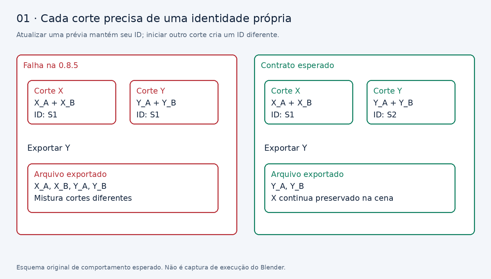
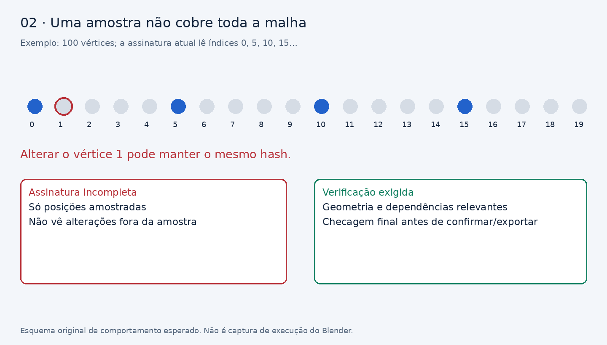
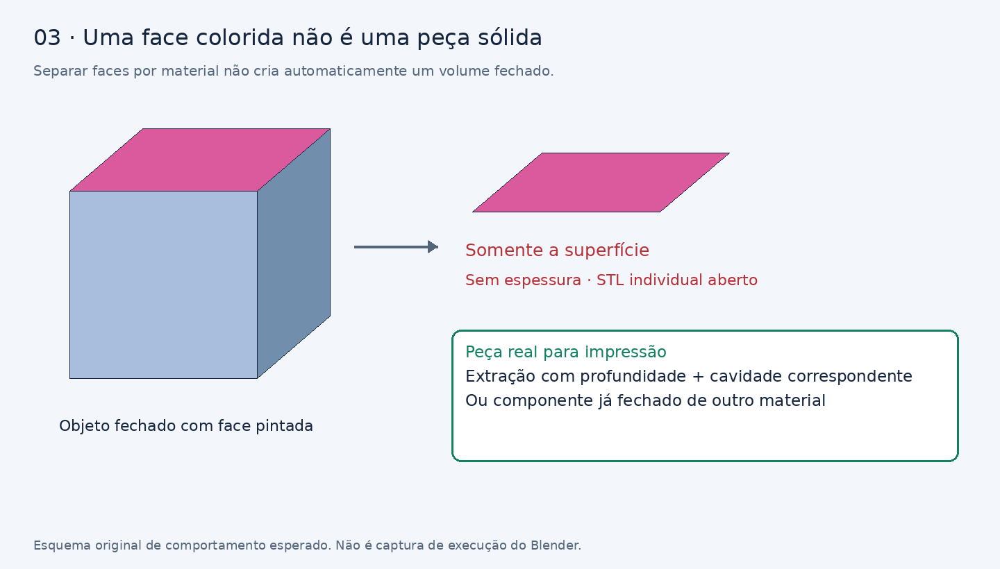
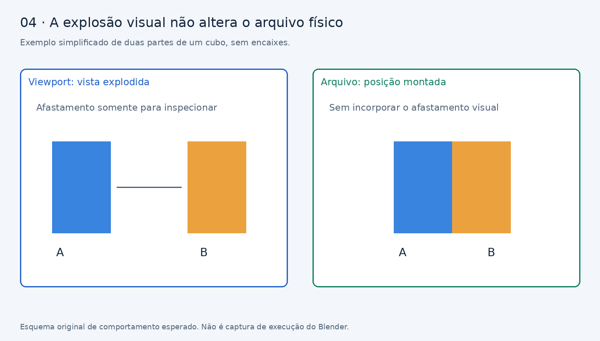

# Chest Part Splitter 0.8.5 — correções verificáveis para Gemini Pro

**Base analisada:** `chest_part_splitter-0.8.5.zip` • revisão de 9 de outubro de 2026.

SHA-256 do ZIP: `feb7c09d60dae697d779445396428f39f0371506556601a9899c472aaee9661e`.

## 1. Missão e resultado esperado

Você está no repositório da extensão Blender Chest Part Splitter. Corrija os bloqueadores ainda presentes na 0.8.5, preservando as funcionalidades que já funcionam. O objetivo é preparar uma candidata para testes de venda e tutoriais em português e inglês, com cortes, encaixes e exportações consistentes e sem apagar objetos do usuário.

Leia este documento inteiro antes de alterar código. Confronte os nomes das funções e os trechos citados com o repositório atual. Se houver mudanças posteriores à 0.8.5, não reverta correções existentes: use os critérios de aceitação para verificar a implementação atual. Não acrescente articulações, novos modos de corte, automações ou reformulações da interface nesta tarefa.

Entregue código, testes de regressão, ZIP candidato, relatório de resultados reais e lista de pendências. Não encerre com um plano sem implementar as correções. Se faltar Blender no ambiente, implemente o que for possível e marque os testes de Blender como **não executados**. Não declare aprovação total por análise estática ou por contagem de testes cujo conteúdo não verifica os requisitos.

As imagens deste pacote explicam os contratos esperados. Elas não demonstram que a extensão foi executada. Os sites são apoio técnico; os defeitos listados são fundamentados no código da extensão.

## 2. O que foi verificado nesta revisão

| Evidência | Resultado | Limite |
|---|---|---|
| Compilação sintática dos 15 arquivos Python | Passou | Não executa bpy/BMesh nem instala a extensão |
| Resolver de peças com dois cortes usando o mesmo ID | Retornou os dois cortes | Teste isolado com objetos simulados |
| Resolver de prévia com ID antigo e papel PREVIEW_A | Incluiu a prévia antiga | Teste isolado da função original |
| Alterar vértice não amostrado pela assinatura | Assinatura permaneceu igual | Teste isolado da função original |
| Execução de cortes/encaixes no Blender | Não executada | Blender não disponível no ambiente da análise |
| Testes citados no changelog | Não reproduzidos | Não incluídos no ZIP de instalação |

Um ZIP de instalação pode omitir testes. Não trate essa ausência como prova de que eles não existem no repositório, nem como prova de aprovação. Localize os testes existentes e execute-os com evidências.

### Correções da 0.8.5 a preservar

Coleção própria para cópia de trabalho; retorno explícito do operador de exportação; `global_scale=unit_scale` e `use_scene_unit=False` no STL; escala física do OBJ; escape XML com `html.escape`; gravação do 3MF com `os.replace`; ajuda com fallback inglês; validação geométrica durante geração da prévia; restauração de posição após exportação explodida; callbacks de troca de alvo/cortador. Preserve e teste essas melhorias; não suponha que abrangem todos os caminhos.

## 3. Mapa de código da 0.8.5

| Área | Arquivo e referência |
|---|---|
| Exclusão de objetos | `src/operators.py`, `cleanup_collection_objects`, linha 83 |
| Validação geométrica | `src/operators.py`, `validate_printable_mesh`, linha 145 |
| Assinatura das entradas | `src/operators.py`, `compute_session_input_signature`, linha 248 |
| Atualidade da prévia | `src/operators.py`, `verify_preview_current`, linha 327 |
| Resolver das peças atuais | `src/operators.py`, `get_current_session_parts`, linha 349 |
| Definir/limpar alvo | `src/operators.py`, classes a partir das linhas 483 e 540 |
| Gerar prévia | `src/operators.py`, `CHEST_OT_splitter_generate_preview`, linha 802 |
| Confirmar peças | `src/operators.py`, `CHEST_OT_splitter_commit_parts`, linha 1392 |
| Restaurar/refazer | `src/operators.py`, classes a partir das linhas 1474 e 1521 |
| Separar por material | `src/operators.py`, `CHEST_OT_splitter_separate_by_material`, linha 1628 |
| Exportar | `src/operators.py`, `CHEST_OT_splitter_export_parts`, linha 1702 |
| Handler | `src/operators.py`, `on_depsgraph_update_post`, linha 2013 |
| Subobjetos por material | `src/io_export.py`, `separate_object_by_material`, linha 185 |
| STL por material | `src/io_export.py`, `export_objects_to_stl_by_material`, linha 250 |
| Assinatura de topologia | `src/geometry_loop.py`, `get_topology_signature`, linha 34 |
| Estado/metadados | `src/properties.py`, `src/constants.py` |

As linhas são localizadores, não instruções de substituição cega. A pasta `referencia_085` contém os arquivos correspondentes para comparação.

## 4. B01 — identidade de sessão reaproveitada em cortes diferentes

**Prioridade:** alta. **Evidência confirmada no código e no resolver isolado.**

Trecho da geração de prévia:

```python
if not settings.session_id or settings.session_id == "session_01":
    settings.session_id = uuid.uuid4().hex[:8]
```

Essa é a única atribuição de `settings.session_id` encontrada em `operators.py`. Definir outro alvo, limpar o alvo ou reabrir o corte não define uma nova identidade. Quando o primeiro corte recebe um UUID, os próximos podem continuar com esse mesmo valor. O filtro das peças confirmadas então aceita peças de mais de um corte.



### Reprodução no Blender

1. Criar dois cubos fechados separados, chamados `Teste_X` e `Teste_Y`.
2. Definir X como alvo, gerar prévia sem encaixes e confirmar.
3. Registrar o ID nos objetos X_A/X_B e o ID ativo.
4. Definir Y como alvo, gerar e confirmar outro corte.
5. Comparar os IDs e exportar Y em 3MF/STL.
6. Repetir no mesmo alvo usando o comando de refazer/novo corte, mantendo o corte anterior na cena.

**Esperado:** X e Y têm identidades distintas; a exportação de Y contém somente as peças de Y. Atualizar a mesma prévia mantém a identidade dela.

### Implementação exigida

- Centralize o início de um corte numa função de ciclo de vida. Uma nova identidade pertence ao novo corte, não a cada clique de atualizar prévia.
- Diferencie explicitamente atualizar um resultado ainda não confirmado de iniciar uma nova revisão/corte preservando resultados confirmados.
- Ao reabrir um corte confirmado, defina uma política inequívoca: novo ID para a nova candidata, com referência ao corte anterior se necessário. Não acumule resultados diferentes sob o mesmo ID.
- Mantenha identidade persistente após salvar/reabrir a cena. Use UUID completo ou uma representação cuja colisão seja tratada; o prefixo atual de oito caracteres não precisa ser preservado.
- Objetos derivados herdam a sessão da origem, com identidade própria de resultado e vínculo de derivação quando necessário.
- Não apague cortes antigos para esconder o problema de seleção.
- Trate dados legados sem metadados com migração conservadora. Prefixo do nome não é identificação segura: `Teste_X` também pode corresponder a `Teste_X_backup`.

**Teste de aceitação:** dois cortes confirmados consecutivos e atualizações de prévia intermediárias; exportar e separar por material apenas o corte ativo. X e Y continuam intactos e possuem IDs distintos.

## 5. B02 — resolver aceita papel/nome sem exigir sessão atual

**Prioridade:** alta. **Reproduzido em teste isolado.**

O filtro da prévia atualmente aceita:

```python
o.get("chest_session_id") == curr_sid
or o.name in (PREVIEW_A_NAME, PREVIEW_B_NAME)
or o.get("chest_role") in (...)
```

Uma prévia de sessão antiga com papel PREVIEW_A passa pelo último `or`. Um objeto de usuário com nome reservado também pode ser selecionado pelo nome, mesmo sem vínculo da sessão.

### Correção

Exija propriedade da extensão **e** sessão atual **e** papel compatível **e** participação no conjunto de resultados ativos. Nomes são rótulos mutáveis. Subpeças válidas podem ter substituído as partes A/B; essa relação precisa existir no estado e não ser inferida pelo nome.

Pseudocódigo orientativo, não um patch literal:

```python
owned = obj.get("chest_owner") == OWNER_ID
same_cut = bool(current_id) and obj.get("chest_session_id") == current_id
role_ok = obj.get("chest_role") in roles_allowed_for_state
active_result = result_registry.contains(obj)
eligible = owned and same_cut and role_ok and active_result
```

Não adicione um novo campo obrigatório sem migrar as peças da 0.8.5. Uma sessão vazia jamais deve combinar com objetos sem ID e produzir seleção acidental. Valide cardinalidade e completude do conjunto: ausência de parte esperada é falha, não autorização para exportar somente a parte restante.

**Aceitação:** colocar uma prévia antiga marcada na coleção, uma malha do usuário com nome semelhante e resultados da sessão atual. O resolver deve retornar exatamente os atuais. Testar renomeação das peças e ID ativo vazio.

## 6. B03 — limpeza ainda apaga objetos pelo nome da coleção

**Prioridade:** crítica para proteção da cena. **Defeito observável no código; executar reprodução em cena descartável.**

Condição atual:

```python
if is_preview_obj or collection.name == COLLECTION_PREVIEWS_NAME:
    bpy.data.objects.remove(obj, do_unlink=True)
```

O nome da coleção basta para excluir qualquer objeto não protegido. Há também identificação por sufixo `_preview`, nomes fixos ou apenas igualdade de ID. Nenhum desses isoladamente comprova que a malha seja descartável.

### Reprodução

Colocar uma malha fechada `Objeto_do_usuario` sem metadados dentro da coleção de prévias; gerar/atualizar um corte e verificar sua sobrevivência. Repetir com um objeto vinculado tanto à coleção de prévias quanto a uma coleção pessoal: `do_unlink=True` remove o datablock globalmente, não apenas o vínculo local.

### Correção

- Excluir somente objetos cuja propriedade, sessão e papel descartável estejam comprovados.
- Preservar alvo, original, cópias de trabalho, peças finais e outros objetos, independentemente da coleção.
- Para migrar prévias antigas, identifique-as por referências persistidas confiáveis. Se isso não for possível, preserve e sinalize; não exclua por semelhança de nome.
- Diferencie desvincular uma coleção de apagar um objeto do arquivo inteiro.
- Passe cena/sessão explicitamente à limpeza; não use `bpy.context.scene` como autoridade universal para uma operação iniciada em outra cena.
- O `finally` deve limpar somente temporários criados por aquela operação. Objetos compartilhados ou malhas com outros usuários não devem ser removidos indiscriminadamente.

**Aceitação:** atualização, restauração, limpar alvo e falha de encaixe deixam intactos objetos do usuário e cortes antigos. Temporários da operação são removidos; não ficam malhas órfãs novas após execuções repetidas.

## 7. B04 — assinatura não detecta alterações relevantes

**Prioridade:** alta. **Amostragem insuficiente reproduzida em teste isolado.**

Trecho atual:

```python
step = max(1, len(m.vertices) // 20)
for i in range(0, len(m.vertices), step):
    co = m.vertices[i].co
```

Em uma malha de 100 vértices, os índices 0, 5, 10… são lidos. Alterar o índice 1 não muda a assinatura. A assinatura do cortador inclui contagens, mas não suas posições; mudar sua forma preservando contagens também pode passar. Materiais são representados pelos nomes dos slots, sem os índices por face. Modificadores relevantes não são integralmente representados. A assinatura de topologia do loop também usa amostra de arestas.



### Reprodução e critérios

1. Gerar prévia de um objeto suficientemente subdividido.
2. Alterar apenas um vértice fora da amostra atual; tentar confirmar/exportar.
3. Alterar conectividade sem mudar quantidades V/E/F.
4. Mudar material de faces preservando nomes dos slots.
5. Alterar a malha do cortador mantendo as contagens.
6. Mudar um parâmetro de modificador que afete a geometria.
7. Mover um objeto pai de alvo/cortador; alterar escala física da cena.

Todos os casos relevantes devem invalidar a prévia ou exigir regeneração. Mudar apenas explosão/contraste visual não deve invalidá-la.

### Estratégia recomendada

Use eventos de atualização para marcar dependências como sujas e uma verificação final autoritativa antes de confirmar/exportar/separar. Uma assinatura completa, snapshot ou revisão de geometria pode servir, desde que não ignore alterações. Não troque uma amostra incompleta por outra maior e mantenha a promessa de detecção integral.

- Cubra posições, conectividade, materiais por face quando relevantes, transformações mundiais, unidades, parâmetros e geometria avaliada conforme a política de modificadores.
- Para malhas grandes, leia buffers por métodos eficientes e use cache invalidado por eventos; não percorra milhões de elementos em todo desenho da HUD.
- A checagem final deve funcionar mesmo quando o handler não executou a tempo.
- No handler, use a cena e o depsgraph recebidos. Normalize IDs originais/avaliados quando aplicável e observe atualizações de Mesh e dependências relevantes, não apenas objetos da lista.
- Evite que consultar a assinatura crie guias, altere propriedades derivadas ou cause efeitos colaterais. A atual chamada a `read_plane_geometry()` escreve nas configurações.
- Cadastre e remova handlers corretamente; teste load, undo/redo e desativar/reativar a extensão.
- Em Edit Mode, sincronize/consulte a geometria apropriada. Não capture dados desatualizados do Mesh quando a versão editável está no BMesh.
- Uma mudança topológica invalida índices capturados de loop/face. Uma deformação sem troca de conectividade exige regeneração, mas pode preservar a seleção topológica se ainda for válida.

## 8. B05 — resultado editado depois da prévia não é revalidado integralmente

**Prioridade:** alta. **Defeito confirmado por leitura dos caminhos de confirmação/exportação.**

A geração usa `validate_printable_mesh()` antes/depois dos encaixes, mas `verify_preview_current()` verifica essencialmente objetos A/B e assinatura das entradas. Alterar as peças geradas não altera necessariamente o alvo original. A confirmação não repete a validação completa; a exportação exige faces/vértices e usa avisos guardados em propriedades apenas em um formato.

### Reprodução

Gerar uma prévia válida; entrar em Edit Mode numa parte e apagar uma face; voltar e confirmar/exportar. Repetir após a confirmação, editando a peça final. Repetir apagando somente uma das partes e deixando a outra na coleção.

### Contrato exigido

Revalidar a geometria efetivamente usada no destino, não só um flag calculado anteriormente. Peças de prévia alteradas fora da extensão devem ser marcadas como alteradas ou exigir regeneração antes de confirmar. Peças finais podem permitir edição manual, desde que a exportação verifique seus dados atuais e o conjunto continue completo.

Critérios mínimos: existência de todos os resultados esperados, geometria não vazia, coordenadas finitas, volume positivo não desprezível e malha fechada/manifold para exportação de sólidos. Escolha tolerâncias físicas documentadas. Arestas manifold não garantem ausência de toda auto-interseção, orientação correta ou espessura imprimível: não prometa certificação universal.

Compartilhe o serviço de validação entre geração, confirmação e exportação, evitando importação circular entre IO e operadores. Pode mover regras geométricas para um módulo de domínio se isso facilitar reutilização. Valide antes de gravar qualquer arquivo do lote, evitando exportar a primeira parte e descobrir que a segunda era inválida.

Conservação de volume deve ser verificada antes dos encaixes e conforme o tipo de corte. Não exigir soma final igual à original depois de criar pinos e folgas. Não reparar automaticamente a malha do usuário nem fechar todos os furos sem autorização do fluxo.

## 9. B06 — STL por material ainda grava superfícies abertas

**Prioridade:** alta. **Defeito confirmado pela leitura de `export_objects_to_stl_by_material()`.**

Separar faces coloridas de uma malha fechada frequentemente produz superfícies abertas. `separate_object_by_material()` detecta e registra isso; a rotina de STL por material não exige fechamento e grava os objetos. A checagem de metadados no operador principal só aparece quando `export_format == 'STL_PARTS'` e não cobre os subobjetos criados depois.



### Reprodução

Cuboid fechado com uma face pintada de outro material → corte válido → exportar STL por material. Inspecionar os STLs individualmente: um pode ser apenas a face pintada, e o outro o restante aberto.

### Correção

- Antes de qualquer gravação, crie e valide todos os subobjetos derivados.
- Se uma região for apenas superficial, bloqueie a exportação de sólidos individuais e explique como obter peças reais: corte por Material com profundidade ou outra operação explicitamente suportada.
- Não use `holes_fill` indiscriminadamente para inventar um volume: a tampa pode criar sobreposição, destruir concavidades e produzir geometria sem relação com a peça pretendida.
- Uma peça já separada como componente fechado pode ser exportada normalmente.
- Preserve a opção 3MF com cores por triângulo de uma malha original fechada, se esse caminho respeitar o contrato. Não force toda pintura superficial a virar uma peça independente.
- Se exportação técnica de superfícies abertas for mantida, deve ser uma ação explícita fora do fluxo anunciado como sólido imprimível; não é necessária para resolver esta tarefa.
- Verifique o retorno dos operadores STL também na rotina por material. Não contabilize arquivo como exportado quando houver cancelamento.

**Aceitação:** exemplo da face pintada bloqueia STL individual aberto; dois componentes fechados de materiais distintos passam. 3MF do objeto fechado continua legível com suas cores, sem promessa automática de filamentos atribuídos pelo fatiador.

## 10. B07 — separação por material quebra referências da prévia

**Prioridade:** alta se a ação permanecer disponível antes de confirmar. **Defeito observável na sequência atual.**

O operador de separação cria subobjetos na coleção de prévias e desvincula A/B. `verify_preview_current()` e confirmação ainda procuram A/B pelos nomes fixos. O estado permanece em PREVIEW_VALID mesmo quando os objetos procurados deixaram de estar na coleção.

### Solução preferencial de menor risco

Permita separação por material apenas após COMMITTED e mantenha A/B como resultados canônicos da prévia. Ajuste `poll`, HUD, ajuda e mensagem para explicar “Confirme o corte antes de separar por material”. Depois da confirmação, subpeças podem substituir partes por meio de um registro explícito, preservando sessão, identidade da parte de origem e completude.

Essa restrição é uma correção de fluxo, não uma funcionalidade nova. Se decidir manter separação antes da confirmação, implemente de ponta a ponta um registro que reconheça os resultados derivados para verificar, confirmar, exportar e atualizar; não basta relaxar a procura de A/B.

Escolha uma política e documente-a. Não deixe controles operáveis que conduzam a estado inválido. Se o caminho mais simples for adotado, teste que separar em prévia é indisponível e que a ação após confirmar funciona.

## 11. Modificadores, posições e contratos físicos

A 0.8.5 avalia modificadores no corte PLANE/SOLID. Contorno/material ainda exigem coerência com os índices de Edit Mode e geometrias copiadas. Revise esse ponto sem presumir correção universal.

- Diagnóstico, corte, validação e exportação devem usar a mesma interpretação da geometria suportada.
- Não aplicar destrutivamente modificadores do original para facilitar teste.
- Se os índices capturados no Mesh base não puderem mapear com segurança para a malha avaliada, bloqueie esse caso e oriente uma cópia consolidada.
- Libere a malha temporária no mesmo objeto avaliado que a criou, em `finally`.
- Atualizações sucessivas precisam funcionar mesmo com o alvo ocultado depois da primeira prévia. Não regredir o problema de depsgraph ignorando objetos ocultos já tratado nas versões anteriores.



A vista explodida é apresentação. O arquivo deve preservar o alinhamento montado canônico. Prefira snapshots de exportação para evitar mover temporariamente peças do usuário e disparar handlers; se mantiver movimentação/restauração, teste falha, seleção, modo e estado da sessão. Ao derivar subpeças numa vista explodida, garanta que o deslocamento visual não seja confundido com posicionamento físico.

Unidades: STL/OBJ numéricos em mm conforme a convenção da extensão, 3MF com unidade declarada mm. Testar peça de 40 × 30 × 20 mm com `scale_length=1`, `0.01` e `0.001`. `unit_scale = scale_length × 1000`. Não duplicar conversão ao usar `use_scene_unit`. Conferir separadamente escala do objeto e escala da cena.

## 12. Referências visuais e imagens de comprovação

As quatro imagens locais são originais e esquemáticas, sem reprodução de capturas externas. Use-as para entender comportamento, não como modelo de HUD a copiar. Preserve o layout da extensão nesta tarefa.

### Sites com referências visuais

| Referência | Link | O que observar | Limite |
|---|---|---|---|
| Bisect, Manual Blender | https://docs.blender.org/manual/en/latest/modeling/meshes/editing/mesh/bisect.html | Plano de corte, remoção de lados e fechamento | Não demonstra robustez da extensão |
| Boolean Modifier, Manual Blender | https://docs.blender.org/manual/en/latest/modeling/modifiers/generate/booleans.html | União, diferença e interseção | UI/API variam com versão |
| 3D Print Toolbox, Manual 4.1 | https://docs.blender.org/manual/en/4.1/addons/mesh/3d_print_toolbox.html | Painéis e verificações de sólidos | Referência visual histórica, não instalação de 4.2+ |
| 3D Print Toolbox, catálogo oficial | https://extensions.blender.org/add-ons/print3d-toolbox/ | Página visual da extensão de diagnóstico | Não é dependência obrigatória do Chest |

A busca confirmou essas páginas; algumas tentativas de abertura integral retornaram erro de acesso nesta revisão. Não invente URLs de imagens nem declare ter inspecionado capturas específicas que não puder abrir. Acesse as páginas no ambiente de implementação e use as imagens ali disponíveis apenas como referência. Não reutilize capturas externas como resultados de teste do Chest.

### Capturas reais que você deve produzir após implementar

| ID | Cena/imagem solicitada | Evidência que precisa aparecer |
|---|---|---|
| IMG-01 | Dois cortes X/Y confirmados, Outliner e propriedades | IDs distintos e quatro peças preservadas |
| IMG-02 | Exportação de Y aberta no fatiador | Somente Y; dimensões físicas visíveis |
| IMG-03 | Objeto do usuário dentro da coleção de prévias | Objeto existe antes/depois da limpeza |
| IMG-04 | Vértice alterado fora da amostra antiga | Aviso de prévia desatualizada e ação bloqueada |
| IMG-05 | Peça gerada com uma face removida | Diagnóstico e cancelamento antes de gravar |
| IMG-06 | Face colorida superficial, STL por material | Aviso de casca e ausência de arquivo sólido inválido |
| IMG-07 | Separação por material no fluxo escolhido | Estado coerente antes/depois de confirmar |
| IMG-08 | Prévia montada/explodida e arquivo importado | Mesmo alinhamento exportado |
| IMG-09 | Ajuda PT/EN | Tooltip/popup no idioma correspondente |
| IMG-10 | Encaixe impresso e montado | Foto real, material/folga identificados pelo usuário |

Não fabricar IMG-10: depende de impressão física. Se uma captura real não puder ser produzida, marque pendente. Um print da viewport não comprova folga física nem resistência.

## 13. Referências técnicas oficiais, com função de cada uma

**R-API-01 — Operadores e estados de retorno**

https://docs.blender.org/api/5.0/bpy.types.Operator.html

Use para confirmar contratos de `poll`, `execute`, retorno e undo. Validar contexto e retorno dos operadores chamados é responsabilidade da implementação.

**R-API-02 — Exportadores WM, STL/OBJ**

https://docs.blender.org/api/5.0/bpy.ops.wm.html

Use para conferir argumentos de escala, seleção, modificadores e unidades. Consulte a documentação correspondente à versão executada antes de assumir suporte a um argumento.

**R-API-03 — Dependency graph e malha avaliada**

https://docs.blender.org/api/5.0/bpy.types.Depsgraph.html

Use para obter geometria avaliada e gerenciar snapshots. Não reutilize temporários depois de liberados nem deixe meshes temporários sem limpeza.

**R-API-04 — Handlers**

https://docs.blender.org/api/5.0/bpy.app.handlers.html

Use para callbacks de atualização, persistência e registro/remoção. Não use handler como única barreira antes de gravar arquivo.

**R-3MF-01 — Especificações do consórcio**

https://3mf.io/spec/

Portal oficial para Core, Materials e ferramentas de conformidade. A validade do XML não comprova por si só a correta importação da geometria ou dos materiais.

**R-3MF-02 — Repositórios de especificação**

https://github.com/3MFConsortium/spec_core

https://github.com/3MFConsortium/spec_materials

Use para conferir estrutura do pacote, recursos, objetos, unidades e propriedades de cor. Não reescreva o exportador 3MF inteiro sem uma falha concreta que justifique.

As APIs citadas em 5.0 são referências técnicas verificadas por busca. Para declarar compatibilidade mínima 4.2, execute em 4.2 e confira sua API; o manifesto atual não substitui evidência de compatibilidade.

## 14. Sequência de implementação e arquitetura sugerida

1. Criar testes que reproduzem B01/B02/B03 antes de alterar comportamento.
2. Definir propriedade de objetos, identidade de corte e conjunto de resultados. Resolver e limpeza usam esse contrato compartilhado.
3. Implementar ciclo de vida de sessões e migração conservadora. Não produzir IDs novos a cada atualização.
4. Corrigir assinatura/invalidação e o tratamento de loop/topologia. Cobrir entrada e resultados, mantendo bom desempenho.
5. Reutilizar validação geométrica nos limites de confirmação/exportação e em subpeças de material.
6. Escolher e implementar fluxo coerente para separação por material.
7. Testar exportação, modificadores, falhas de IO, contexto e undo/redo.
8. Atualizar documentação somente depois de saber o comportamento final.

Módulos sugeridos, não obrigatórios: sessão/resultados (identidade e resolver), validação geométrica (sem dependência de UI), snapshots/assinaturas e IO. Não espalhe o mesmo predicado de propriedade em cinco lugares. Não mova todos os arquivos apenas por estética.

Estado esperado: CONFIGURED → prévia candidata temporária → validar → PREVIEW_VALID → revalidar → COMMITTED. Qualquer alteração relevante leva a PREVIEW_STALE; falha de geração leva a PREVIEW_INVALID. Substituição da prévia deve acontecer depois da nova candidata passar, ou deve haver restauração segura do alvo se a política for descartar a anterior.

Nunca use a manutenção de uma prévia antiga como autorização para exportá-la quando as entradas mudaram.

## 15. Matriz mínima de testes de regressão

| Teste | Preparação/ação | Resultado obrigatório |
|---|---|---|
| T01 | Definir X, confirmar; definir Y, confirmar | IDs distintos; Y exporta só Y |
| T02 | Atualizar a mesma prévia três vezes | ID estável; sem objetos duplicados |
| T03 | Reabrir/novo corte no mesmo alvo | Política de revisão respeitada; anterior preservado |
| T04 | ID atual vazio | Resolver não aceita objetos sem ID |
| T05 | Prévia antiga com papel válido | Excluída do resolver atual |
| T06 | Objeto com nome reservado mas sem propriedade | Preservado e excluído do resultado |
| T07 | Objeto do usuário em coleção de prévias | Sobrevive a todas as limpezas |
| T08 | Objeto vinculado a duas coleções | Nenhuma exclusão global acidental |
| T09 | Vértice fora da amostra antiga modificado | Prévia invalidada antes de ação |
| T10 | Conectividade alterada com V/E/F iguais | Topologia capturada invalidada |
| T11 | Cortador deformado com contagens iguais | Prévia invalidada |
| T12 | Material por face alterado, slots iguais | Invalidação no modo dependente de material |
| T13 | Modificador alterado ou pai movido | Invalidação/resultado conforme geometria avaliada |
| T14 | Escala física da cena alterada | Prévia invalidada |
| T15 | Explosão/contraste alterados | Prévia continua atual |
| T16 | Apagar face de uma prévia | Confirmar/exportar bloqueados por integridade |
| T17 | Apagar face após COMMITTED | Exportação revalida e bloqueia |
| T18 | Remover uma parte, outra permanece | Falha de conjunto incompleto |
| T19 | Face pintada separada para STL | Casca bloqueada antes de gravação |
| T20 | Componentes já fechados por material | STLs fechados e corretos |
| T21 | Separar por material antes de confirmar | Fluxo escolhido coerente; sem estado impossível |
| T22 | Peça 40×30×20 mm em 3 escalas de cena | STL/3MF com medidas corretas no fatiador |
| T23 | Exportar montado e explodido | Mesmo alinhamento e geometria física |
| T24 | Pasta sem permissão/cancelamento de exportador | CANCELLED, contexto restaurado e sem falso sucesso |
| T25 | Nome com aspas, &, < e > no 3MF | XML parseável e arquivo legível |
| T26 | Save/load, undo/redo, reativar extensão | Referências e handlers coerentes |
| T27 | Cilindro/cápsula, inverter macho/fêmea | Fechamento, união e folga geométrica mantidos |
| T28 | Loop AUTO/DETACH/EXTRUDE e duas ilhas de material | Regressões das funcionalidades existentes passam |
| T29 | Instalação limpa no Blender mínimo e versão usada | Registro/ativação sem erro |
| T30 | Idioma PT e EN, HUD/ajudas | Traduções e mensagens coerentes |

Os testes devem usar as funções reais do projeto, e testar operadores integrais no Blender quando possível. Um teste que verifica apenas existência de função, substring do arquivo ou compilação não satisfaz o requisito funcional.

Para cada teste entregue: nome, versão do Blender, preparo, ação, assertiva, resultado e log. Tests de seletor, viewport, idiomas e fatiador podem ser manuais, mas precisam de registro explícito. Não marque pass quando só criou o arquivo de teste.

### Comandos orientativos

```bash
blender --background --factory-startup --python tests/test_release_regressions.py
blender --command extension validate .
blender --command extension build
```

Ajuste os comandos ao repositório e à versão instalada. O script de testes deve retornar código de saída não zero ao falhar; implemente o tratamento necessário em vez de depender apenas da mensagem no console.

## 16. Regras para evitar correções aparentes

- UUID criado uma vez não resolve novos cortes: teste a transição completa.
- `or role` ou `or name` não é isolamento por sessão.
- Nome de coleção não autoriza exclusão.
- SHA-256 de uma amostra não detecta o que não foi lido.
- Flag antigo de manifold não valida uma peça editada.
- Separar cor não cria espessura ou volume automaticamente.
- 3MF colorido não garante atribuição automática de filamentos em todos os fatiadores.
- Um fatiador aceitar/reparar uma casca não prova que a exportação da extensão esteja correta.
- Restringir uma ação precisa atualizar o botão e a ajuda, não só gerar erro depois do clique.
- Não alterar original, objetos externos ou arquivos anteriores para mascarar falhas.

## 17. Entregáveis e encerramento

Entregue a candidata com versão coerente entre manifesto, `bl_info`, README e changelog, escolhendo a próxima versão de acordo com o repositório atual. Não chame de estável antes dos testes necessários.

Inclua no relatório uma tabela B01–B07 com causa, solução, arquivos, testes e status. Informe regressões de modificadores/unidades e decisões sobre a separação por material. Inclua capturas reais IMG-01–IMG-09 quando o ambiente permitir; IMG-10 depende do usuário.

Feche somente quando os bloqueadores forem corrigidos e verificados, ou quando uma limitação do ambiente estiver claramente registrada. Se um teste falhar, investigue e corrija; não mude a assertiva apenas para fazê-lo passar. Após corrigir a causa, execute novamente os testes afetados e o conjunto de regressões pertinente.

O usuário vai testar e gravar tutoriais com esse ZIP. O fluxo mínimo deve ser confiável: instalar → escolher alvo → preservar original → cortar → encaixar → conferir → confirmar → exportar → abrir no fatiador. Impressão e montagem física continuam sendo verificação final do usuário, com material, impressora e folga registrados.
