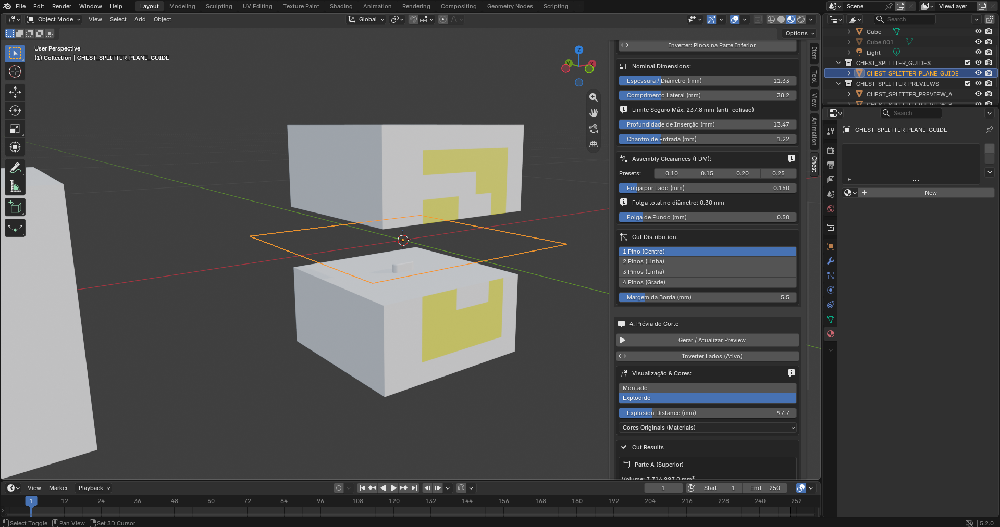
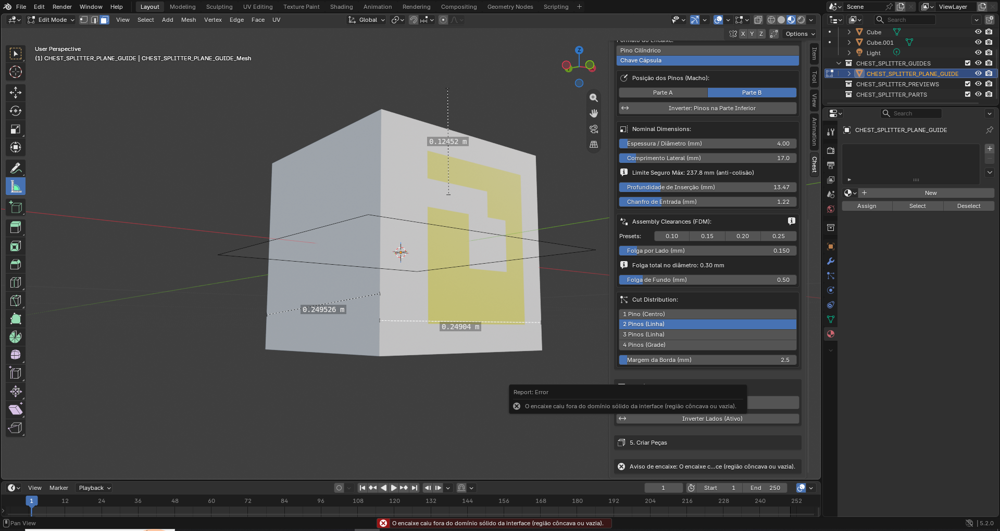
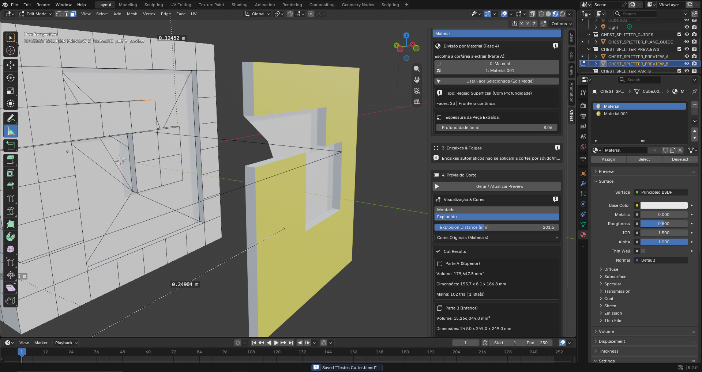

# Chest Part Splitter — plano comercial de 0.8.5 para 0.8.6

Documento de implementação para Antigravity / Gemini Pro · 10/10/2026

## 1. Objetivo e base exata

Preparar uma candidata de lançamento que permita selecionar a área desejada, visualizar claramente o corte, gerar sólidos imprimíveis e exportar resultados confiáveis. Priorizar estabilidade e previsibilidade; adicionar somente as duas melhorias de Loop discutidas hoje: contorno destacado e captura do perímetro de uma seleção de faces.

Base analisada: `chest-blender-part-splitter-0.8.5.zip`, enviado em 10/10/2026. SHA-256: `33673fff35715ab441b32e3e2e1950eb3b4b225ea3117e47e5081ff121267b9f`.

O `bl_info` declara `(0, 8, 5)` e Blender mínimo `(4, 2, 0)`. As capturas mostram Blender 5.2.0. Foram verificados 39 arquivos Python, sem erros de sintaxe. Não houve execução no Blender neste ambiente, nem reprodução nativa do crash. Não declarar aprovação funcional com base nesta revisão.

**0.8.6 é a versão proposta para as mudanças**, não uma versão já concluída. A versão comercial final poderá ser numerada 1.0.0 quando cumprir os critérios de liberação; não aumentar a versão para insinuar estabilidade antes dos testes. Se o repositório tiver avançado, comparar o código atual com esta base e adaptar referências, preservando correções novas.

Este plano complementa os documentos anteriores e substitui suas instruções nos pontos que tratam dos problemas abaixo. Não reaplicar correções já presentes nem executar planos históricos indiscriminadamente.

## 2. Escopo da primeira versão comercial

| Prioridade | Entrega | Motivo |
|---|---|---|
| P0 | Atualização de prévia segura, inclusive em falha | Evitar perda do resultado anterior, alvo invisível e estado incoerente |
| P0 | Investigação de crash após Undo/Redo | Encerramento inesperado bloqueia lançamento até ser investigado e validado |
| P0 | Seleção por face confiável | Cortar a região indicada pelo usuário |
| P0 | Contorno correto no corte planar e encaixes múltiplos | Eliminar falsos avisos de encaixe fora da seção |
| P0 | Investigar e resolver membrana no corte por material | Impedir extração com superfícies ou volumes indevidos |
| P1 | Contorno capturado destacado | Mostrar claramente o limite usado no corte |
| P1 | Capturar contorno das faces | Selecionar uma área e usar seu perímetro sem selecionar cada aresta |
| P1 | Exportação consistente e diagnóstico claro | Gerar arquivos que correspondam à geometria aprovada |

Ficam para depois: articulações, redimensionamento preservando encaixes/folgas, distribuição manual completa, seleção simultânea de várias regiões e suporte geral a múltiplos contornos com buracos na nova captura por faces. Não ampliar o motor de cortes não planares nesta entrega. Preservar o que já funciona e rejeitar claramente os casos sem suporte.

Não criar um redesign completo da interface. Acrescentar os botões necessários, explicações curtas e mensagens acionáveis em português e inglês.

## 3. Evidências e nível de certeza

| ID | Evidência | Conclusão permitida |
|---|---|---|
| B01 | Botão lê `target.data.polygons`, aceita seleção sem validar objeto em edição e usa primeira face selecionada como alternativa | Fragilidade confirmada no código; causa específica da seleção de 5 em vez de 20 faces ainda precisa de reprodução |
| B02 | Ctrl+Z repetido seguido de atualização encerrou o Blender | Crash relatado e documentado; causa nativa não confirmada sem log |
| B03 | Limpeza da prévia ocorre antes do novo cálculo e caminhos de falha retornam `CANCELLED` após alterar dados | Comportamento destrutivo confirmado no código |
| B04 | Pontos de extremos de arestas são usados como polígono sem ordenação do perímetro | Falha de representação confirmada; demonstração isolada reproduz falso negativo |
| B05 | Uma cápsula funciona, duas falham inclusive após diminuir dimensões | Compatível com B04; confirmar na cena real antes de afirmar causalidade definitiva |
| B06 | Face branca atravessa abertura da peça amarela extraída | Anomalia visual confirmada nas capturas; identificar se há face real, sobreposição ou tesselação de exibição |
| F01/F02 | Captura atual usa todas as arestas selecionadas e não há destaque independente | Recursos propostos ainda ausentes nesta base |

Não atribuir automaticamente o crash ao computador. Não afirmar que triangulação ou booleano é a causa comprovada da película. Não considerar arestas desenhadas no fundo do rebaixo como prova suficiente de membrana: o fundo a 8,06 mm é esperado; uma ponte atravessando a reentrância da peça extraída é que precisa ser investigada.

### Referências visuais incluídas

| Arquivo | O que observar |
|---|---|
| `imagens/01_selecao_face.png` | Face apontada pelo usuário |
| `imagens/02_regiao_5_faces.png` | Área de 5 faces selecionada e aviso de prévia desatualizada |
| `imagens/03_crash_undo.png` | Janela de crash e erro de corte não-manifold: A=6, B=6 arestas problemáticas |
| `imagens/04_encaixes_erro.png` | Cápsula e aviso fora do domínio sólido |
| `imagens/05_dois_encaixes.png` | Distribuição com dois encaixes e mesmas medidas |
| `imagens/06_bloco_plano.png` | Forma geral do alvo e orientação do plano |
| `imagens/07_um_encaixe_funciona.png` | Prévia válida com um encaixe |
| `imagens/08_medidas_secao.png` | Medidas aproximadas da seção: 249 mm por lado |
| `imagens/09_dois_menores_falham.png` | Dois encaixes de 4 × 17 mm, margem 2,5 mm; mesmo aviso |
| `imagens/10_material_montado.png` | Região de 23 faces e profundidade 8,06 mm |
| `imagens/11_material_explodido.png` | Peças separadas e ponte visual |
| `imagens/12_membrana_detalhe.png` | Face branca atravessando reentrância da peça amarela |
| `imagens/13_material_original.png` | Forma original da região pintada |

## 4. Mapa do código desta base

Linhas indicativas; procurar também pelo símbolo, pois mudarão durante a implementação.

| Arquivo | Símbolo e linhas |
|---|---|
| `src/operators.py` | `cleanup_collection_objects`, 83–149; `compute_session_input_signature`, 255–373; `verify_preview_current`, 376–408 |
| `src/operators.py` | `CHEST_OT_splitter_generate_preview`, 876–1376; `CHEST_OT_splitter_commit_parts`, 1466–1584 |
| `src/operators.py` | `CHEST_OT_splitter_capture_loop`, 1662–1706; `CHEST_OT_splitter_export_parts`, 1805–2009 |
| `src/operators.py` | `CHEST_OT_splitter_pick_material_region`, 2065–2100; `on_depsgraph_update_post`, 2133–2175 |
| `src/geometry_material.py` | `find_region_of_face`, 93–105; `analyze_material_structure`, 108–232; `slice_mesh_by_material`, 235–429 |
| `src/geometry_plane.py` | `slice_mesh_by_plane`, 156–247 |
| `src/geometry_contract.py` | `build_cut_interface`, 48–152 |
| `src/geometry_connectors.py` | `point_in_polygon_2d`, 25–38; `compute_connector_layout`, 221–427 |
| `src/geometry_loop.py` | `get_topology_signature`, 34–58; `capture_edge_loop`, 61–145; `create_loop_prism_cutter`, 496–546 |
| `src/io_export.py` | `export_objects_to_stl_by_material`, 252–354 |
| Interface e estado | `src/ui.py`, `src/properties.py`, `src/translations.py` |
| Testes | `tests/run_all_tests.py`, suítes existentes e novas regressões |

Já estão presentes: reinício do ID em Novo Corte, resolução da prévia por sessão/papel, exigência de um A e um B na confirmação, proteção melhor contra exclusão por nome, validação em lote do STL por material e detecção de falhas pelo executor de testes. Preservar essas melhorias.

## 5. B03 — geração de prévia como operação segura

Implementar primeiro, pois todos os outros testes precisam de falha recuperável.

1. Validar alvo, contexto, parâmetros e contorno sem apagar a prévia atual.
2. Guardar apenas o estado necessário para restaurar visibilidade/seleção, dentro da execução corrente. Não guardar referências RNA em caches que sobrevivam a Undo.
3. Criar resultados em temporários isolados, identificados pela execução. Não rotular candidatos como a prévia definitiva antes da aprovação.
4. Calcular corte, encaixes e validação completa nos candidatos.
5. Somente após sucesso substituir o conjunto anterior e publicar a assinatura/estado final.
6. Em falha, remover somente temporários desta execução e restaurar o estado visível. Se não havia prévia, o alvo deve permanecer acessível. Se havia, preservar seu conjunto; se os parâmetros mudaram, mantê-lo explicitamente desatualizado, sem permitir confirmação/exportação indevida.

Usar um guard de execução com `try/finally` para impedir callbacks de posicionamento e monitoramento de interferirem na construção/limpeza. O guard não deve ficar permanentemente ligado após erro. Suprimir somente o processamento transitório necessário e executar uma reconciliação ao final.

Limpeza idempotente: inicializar temporários com `None`, verificar se foram criados e se ainda existem, liberar `to_mesh()` com `to_mesh_clear()` em `finally`, liberar BMeshes próprios em todos os caminhos. Não liberar o BMesh retornado por `from_edit_mesh`, que pertence ao Blender. Remover malhas próprias apenas quando não houver usuários. Não apagar nada com base apenas no nome.

## 6. B01 — seleção por face no objeto correto

O operador deve exigir o alvo original em Edit Mode, com `context.edit_object` e objeto ativo correspondentes ao alvo. Definir comportamento explícito para edição de vários objetos; nesta versão, rejeitar o contexto ambíguo com orientação para editar apenas o alvo.

Ler `bmesh.from_edit_mesh(target.data)` e a face ativa selecionada em `bm.faces.active`. Sem face ativa válida, aceitar somente uma face selecionada. Se houver várias sem uma face ativa válida, não escolher a primeira arbitrariamente; orientar a selecionar a face de referência.

Calcular o componente conectado do mesmo material por compartilhamento de arestas no mesmo BMesh. Atualizar índices quando necessário antes de serializá-los. Não misturar índice de uma peça do preview, de malha avaliada por modificadores e da malha base. O número de faces não determina qual região é correta: uma ilha de 5 faces deve ser escolhida se a face indicada pertence a ela.

Sincronizar a análise/listagem com a malha atual de edição. Ao publicar a escolha, atualizar material e região como uma única alteração lógica. Invalidar a prévia anterior, redesenhar a interface e mostrar o contorno da região efetivamente escolhida. Não gerar booleanos automaticamente neste botão; manter a atualização explícita da prévia.

Mensagens sugeridas:

- PT: “Edite o objeto alvo para escolher uma área. A peça da prévia não pode definir a seleção.”
- EN: “Edit the target object to choose a region. Preview parts cannot define the selection.”
- PT: “Área selecionada: Material.001 — 20 faces. Atualize a prévia.”
- EN: “Selected region: Material.001 — 20 faces. Update the preview.”

## 7. B02 — investigar Undo/Redo e crash

Solicitar/usar o crash log da ocorrência, a cena `.blend`, a versão completa/build do Blender e a sequência exata de ações quando disponíveis. A captura mostra o botão View Crash Log. A ausência desses dados não impede corrigir fragilidades confirmadas; impede declarar a causa nativa comprovada.

### Pontos a revisar

- Não conservar referências a objetos, malhas, BMeshes ou elementos em callbacks/caches após Undo/Redo. Recuperar os dados atuais da cena.
- Reconciliar sessão em Undo/Redo usando handlers adequados. Não transformar cada handler em geração automática de geometria. Invalidação conservadora é aceitável; o alvo, a prévia e a captura precisam continuar coerentes.
- O handler de depsgraph recebe `scene` e `depsgraph`, mas o cálculo atual usa `bpy.context`. Evitar avaliar a cena errada e avaliações desnecessárias dentro desse callback. Preferir marcação de estado pendente e validação autoritativa nos operadores; se houver processamento adiado, não capturar RNA antigo.
- `compute_session_input_signature` passou a usar malha avaliada. Proteger liberação com `finally` e definir assinatura por modo: Material/Loop também dependem da topologia e dos índices da malha base; uma assinatura avaliada sozinha não substitui isso.
- Observar atualizações de dados Mesh, dependências e mudanças relevantes, não apenas objetos. Evitar reconstrução pesada da malha a cada redesenho.
- Revisar geração quando Edit Mode está ativo: sincronizar dados de edição ou transicionar com contexto válido e restaurar estado, sem destruir a malha que está sendo editada.
- Remover `except Exception: pass` onde ele oculta erros úteis, substituindo por registro limitado e mensagem adequada. Não inundar a interface nem registrar dados em cada frame.

Teste repetível: gerar prévia → alterar quantidade/profundidade → gerar → desfazer 1, 3 e 10 vezes → atualizar; repetir com refazer, em Object e Edit Mode. Executar em processo separado para captar crash e preservar logs. Testes em background ajudam, mas não substituem o teste interativo de Undo e callbacks.

## 8. B04/B05 — contorno correto e encaixes múltiplos

### Causa confirmada no código

O corte planar produz `interface_points = [v.co.copy() for e in cut_edges for v in e.verts]`. São extremos repetidos em ordem de enumeração das arestas, não uma caminhada pelo perímetro. `build_cut_interface` transforma essa lista diretamente em `outer_contours_uv`. O teste de inclusão interpreta segmentos que não representam a seção real.

O exemplo isolado em `evidencias/demonstracao_contorno.py` usa a função original extraída por AST. Um retângulo verdadeiro aceita centro e pontos laterais; uma lista possível de extremos de suas arestas aceita o centro e rejeita um lateral interno. Isso demonstra a fragilidade. Não é reprodução nativa da cena nem teste de aprovação da correção.

### Implementação

Reconstruir ciclos pela conectividade das arestas de corte antes de liberar o BMesh. Remover vértice final repetido e duplicações consecutivas; validar fechamento, continuidade, ausência de ramificações e auto-interseção. Não ordenar por ângulo em torno do centroide: isso pode destruir polígonos côncavos.

Representar cada componente externo e seus furos por contenção no plano UV. Se um caso não puder ser representado corretamente nesta entrega, rejeitá-lo com mensagem específica; nunca usar só `outer_contours_uv[0]` silenciosamente para representar toda a seção.

Distribuir candidatos na área sólida com margem real. Para a seção retangular das imagens, preservar o layout simétrico de 1/2/3/4 encaixes. Se o layout falhar, informar posição, limite e motivo. Não reduzir quantidade, diâmetro ou comprimento silenciosamente; o código atual pode ajustar comprimento da cápsula automaticamente, comportamento que deve virar aviso explícito ou rejeição com sugestão.

Validar o perfil completo da cavidade, incluindo folga lateral e distância mínima à borda, não somente o centro. Validar sobreposição entre perfis, orientação da cápsula e profundidade disponível. O “Limite Seguro Máx.” deve corresponder à distribuição e ao domínio atuais; não manter valor antigo após falha.

Conferir as combinações das capturas: 11,33 × 38,2 mm, profundidade 13,47 mm, folga 0,15 mm por lado, fundo 0,50 mm, margem 5,5 mm; depois 4 × 17 mm e margem 2,5 mm. A seção aparente tem aproximadamente 249 × 249 mm. Esses valores guiam reprodução, não substituem o `.blend` original.

## 9. B06 — película na extração por material

A região amarela é côncava, com reentrância aberta, 23 faces e extração de 8,06 mm. A peça A deve preservar essa silhueta; B deve conter o rebaixo complementar. O fundo de B é normal. Uma membrana preenchendo a reentrância de A não é.

### Investigação antes de escolher a correção

1. Isolar A, ocultar B e o alvo, testar em modo sólido sem transparência. Verificar se a película é uma face selecionável e identificar vértices, área, normal e posição em profundidade.
2. Inspecionar o prisma antes do booleano. Registrar contorno ordenado, normal de extração, tampas trianguladas e faces laterais. Não concluir que um n-gon côncavo necessariamente falha: a triangulação precisa ser examinada.
3. Comparar resultado do prisma, interseção A e diferença B. Conferir normais, coincidências de faces, duplicações, espessura zero e triângulos fora do domínio da região.
4. Exportar apenas A e reimportar para confirmar se a face persiste. Conferir no fatiador se há camada preenchendo a abertura.

### Direção preferida de implementação

Para regiões planas, construir o cortador a partir da união das faces da região: triangulação preservando o domínio, tampa deslocada para fora, tampa na profundidade desejada e laterais apenas no perímetro. Faces internas compartilhadas da região não devem gerar paredes internas do prisma. Conservar conectividade e orientação.

Também é aceitável manter a construção pelo contorno se os testes comprovarem sua correção. Não substituir por convex hull ou preenchimento de bounding box, que eliminaria a reentrância. Não tentar esconder a película mudando material, transparência ou seleção.

Validar ausência de pontes fora da área selecionada, sobreposição de interiores A/B e conservação de volume com tolerância documentada. Volume correto e manifold, isoladamente, não descartam uma superfície de espessura zero. Não executar “merge by distance” com tolerância arbitrária que destrua detalhes.

Regiões curvas ou em vários planos precisam de política explícita. Esta entrega não promete extrusão geral por uma normal média; recusar geometrias não suportadas é preferível a criar um sólido errado.

## 10. F01 — destaque persistente do contorno capturado

Mostrar o loop realmente capturado como linha colorida no viewport, independente da seleção atual. Assim o usuário pode selecionar uma face semente sem perder a referência do corte.

- Desenhar as arestas reais em coordenadas mundiais, respeitando transformações e formato não planar. Não substituir por um plano, retângulo ou projeção.
- Oferecer “Mostrar contorno capturado” e diferenciar estado válido de captura invalidada. Não mostrar um loop antigo como atual após mudar topologia, alvo ou sessão.
- Usar overlay GPU com identificação por viewport/contexto. Se usar desenho sobre superfícies, aplicar deslocamento pequeno e comportamento claro de oclusão; restaurar o estado GPU alterado.
- Não criar objetos exportáveis, materiais no modelo ou geometria do contorno. O destaque não deve entrar em volume, booleanos ou exportação.
- Remover handlers no unregister e gerenciar carregamento de arquivo, Undo/Redo e recaptura sem handlers duplicados. Caches do desenho devem guardar números/copias de coordenadas, não elementos BMesh antigos.
- Reposicionar o destaque com a transformação do alvo. Ao invalidar índices por topologia, limpar ou sinalizar a captura antes de desenhá-la.

Usar a mesma infraestrutura para destacar a região escolhida por material quando aplicável. O desenho é uma ajuda visual; a validação dos operadores continua obrigatória.

## 11. F02 — capturar perímetro de faces

Adicionar ao modo Loop o botão **“Capturar contorno das faces” / “Capture face boundary”**, ao lado do fluxo existente para capturar arestas. Não converter silenciosamente a seleção ao simplesmente trocar o método de corte.

Com o alvo em Edit Mode e seleção de faces, capturar apenas arestas com exatamente uma face incidente pertencente à região selecionada. Em uma malha manifold, arestas compartilhadas por duas faces selecionadas são internas e devem ser ignoradas. Detectar/rejeitar incidências ambíguas não-manifold. Na borda física de uma malha aberta pode haver perímetro selecionável, mas o motor de corte continua precisando validar que o alvo atende aos requisitos.

Para uma grade regular 3×3: 9 faces selecionadas, 12 segmentos de aresta no contorno. Essa contagem vale para a grade simples, não para qualquer conjunto de nove faces.

Nesta versão, exigir uma região conectada por arestas e um único ciclo fechado simples. Rejeitar múltiplas ilhas, furos, pontes por vértice, ramificações e seleção de toda a superfície fechada sem perímetro. Não selecionar automaticamente apenas o maior ciclo.

Reutilizar a ordenação e validação do loop existente. Gravar captura e assinatura coerentes com a topologia de edição atual. Só depois do sucesso trocar a seleção para as arestas do perímetro e ativar o destaque F01; falha deve preservar seleção e captura anteriores.

Uma face da seleção original pode definir a semente para Parte A se o método de corte usa essa informação. Guardar essa intenção durante a operação, validar que pertence à região e respeitar a inversão A/B. Não usar índices desatualizados para determinar o lado.

O Blender já oferece Boundary of Selection / Select Boundary Loop. Usar como referência de comportamento; não depender cegamente de `bpy.ops` com contexto de interface incorreto quando BMesh permite implementação determinística.

## 12. Exportação e integridade

Conferir a geometria realmente gravada: malha base ou avaliada deve corresponder à validação. A versão atual confirma peças com malha avaliada, mas algumas exportações validam a base. Estabelecer uma política única por formato e preservar materiais, escala física e posição montada.

Exigir sólidos fechados para exportação como peças físicas. Se cascas por material forem intencionais para uma representação multimaterial, identificá-las explicitamente e validar o conjunto conforme essa finalidade; não prometer que cada casca é um sólido independente imprimível.

A validação prévia em lote do STL por material já foi melhorada. Ainda considerar falha de escrita/exportador após alguns arquivos: usar diretório temporário e publicar o lote após sucesso, ou registrar claramente o resultado parcial sem anunciar sucesso completo. Detectar colisões de nomes sanitizados para evitar sobrescrita entre peças diferentes.

## 13. Sequência de trabalho e testes

**Etapa A:** reproduzir casos, guardar logs e fortalecer temporários/rollback B03. **Etapa B:** corrigir seleção B01 e contorno B04/B05. **Etapa C:** investigar película B06 e Undo B02 até haver explicação e regressão. **Etapa D:** implementar F01/F02. **Etapa E:** validar exportação e executar fluxo comercial completo.

Estimativa para os dois dias disponíveis: primeiro dia nas correções e reproduções; segundo nos testes e recursos de Loop se os bloqueadores estiverem resolvidos. Não tratar o prazo como aprovação automática. Se o crash continuar sem explicação ou reproduzível, adiar venda e finalizar investigação.

| Teste | Ação | Critério de aprovação |
|---|---|---|
| T01 | Escolher faces nas áreas de 5 e 20 faces | Seleciona a região que contém a face, com contagem e destaque corretos |
| T02 | Editar uma peça da prévia e usar botão de material | Rejeita sem alterar a escolha do alvo |
| T03 | Várias faces selecionadas sem ativa válida | Não escolhe arbitrariamente |
| T04 | Alterar geometria/material em Edit Mode | Listagem e captura usam estado atual |
| T05 | Falhar corte com prévia existente | Preserva prévia e alvo, marca estado apropriado, sem temporários restantes |
| T06 | Falha intermediária na criação de temporários | Limpeza segura e erro original preservado |
| T07 | Undo 1/3/10 vezes e atualizar; repetir com Redo | Sem crash, dados inválidos ou peças misturadas |
| T08 | Repetir T07 em interface, com alvo/preview em Edit Mode | Mesmo comportamento seguro; guardar log |
| T09 | Seção retangular subdividida, 1/2/3/4 encaixes | Quantidade solicitada é gerada quando cabe |
| T10 | Repetir T09 com rotação e escala não uniforme | Mesmas medidas físicas e inclusão correta |
| T11 | Seção côncava/furo; centro dentro mas perfil invade borda | Rejeita perfil completo com motivo específico |
| T12 | Encaixes que não cabem/colidem | Não reduz quantidade ou medidas silenciosamente |
| T13 | Região amarela de 23 faces, 8,06 mm | A sem membrana e B com rebaixo complementar |
| T14 | Região retangular, em L e com reentrância profunda | Silhueta preservada em todos os resultados |
| T15 | Exportar/reimportar A do T13 e abrir no fatiador | Sem ponte indevida na abertura |
| T16 | Selecionar grade 3×3 e capturar contorno | 12 arestas, sem internas; semente coerente |
| T17 | Duas ilhas, região com furo e superfície toda selecionada | Rejeita com mensagem e preserva seleção anterior |
| T18 | Capturar contorno e selecionar face semente | Destaque permanece independente da seleção |
| T19 | Transformar alvo e mudar topologia após captura | Destaque acompanha transformações; invalida topologia alterada |
| T20 | Desabilitar/reabilitar addon e carregar arquivo | Sem handlers duplicados, referências antigas ou desenho residual |
| T21 | Exportar montado a partir de prévia explodida | Escala/alinhamento corretos; restaura visualização |
| T22 | Remover A/B ou editar peça para ficar inválida | Confirmação/exportação bloqueadas corretamente |
| T23 | Alterar modificador antes de exportar | Valida a malha efetivamente exportada |
| T24 | Falha de exportador e nomes conflitantes | Sem falso sucesso e sem sobrescrita silenciosa |

Adicionar regressões às suítes existentes e ao executor. Usar Blender com `--background --factory-startup --python-exit-code 1 --python caminho_do_teste.py` onde apropriado. Os testes devem propagar falhas; saída 0 não basta se exceções/asserts forem engolidos. Testes de interface e crash precisam ser registrados separadamente.

Não declarar compatibilidade com todo Blender >=4.2 só pelo metadado. Testar as versões que serão anunciadas, incluindo a usada pelo usuário, ou ajustar a faixa comunicada. Informar sistema operacional, build, testes executados e limitações.

## 14. Critérios de liberação e vídeos

Liberar somente quando os casos básicos suportados completarem seleção → captura → prévia → confirmação → exportação sem contorno errado, membrana ou perda de cena. Falhas devem ser recuperáveis, o Undo/Redo deve passar pelos cenários definidos, e todas as limitações devem estar visíveis na ferramenta/documentação.

Gravar um vídeo em português e outro em inglês usando a mesma cena e sequência: plano com dois encaixes; seleção de faces com captura do contorno; extração por material em formato côncavo. Mostrar o contorno destacado e a exportação para o fatiador. Uma demonstração gravada não substitui testes, mas revela se o fluxo exige contornar defeitos.

Manter exemplos e cenas de teste reproduzíveis. Se não houver impressora disponível, registrar que a verificação foi digital; não afirmar validação de encaixe físico sem impressão.

## 15. Referências oficiais

Referências para consulta pelo implementador; verificar a documentação da versão efetivamente testada. Algumas URLs “current” mudam de versão ao longo do tempo.

- [Seleção de contornos — Blender 5.2](https://docs.blender.org/manual/en/5.2/modeling/meshes/selecting/loops.html): Boundary of Selection, conversão de faces para perímetro.
- [BMesh — Blender 5.0](https://docs.blender.org/api/5.0/bmesh.html): acesso à malha em edição e propriedade dos dados.
- [Tipos BMesh](https://docs.blender.org/api/current/bmesh.types.html): face ativa, índices e conectividade.
- [Erros e crashes — Blender 5.1](https://docs.blender.org/api/5.1/info_gotchas_crashes.html): referências inválidas, remoção de dados e Undo/Redo.
- [Handlers](https://docs.blender.org/api/current/bpy.app.handlers.html): eventos de undo, redo e depsgraph; cuidados ao alterar dados.
- [GPU](https://docs.blender.org/api/current/gpu.html) e [SpaceView3D](https://docs.blender.org/api/current/bpy.types.SpaceView3D.html): desenho e ciclo de vida do destaque.
- [Operações BMesh](https://docs.blender.org/api/current/bmesh.ops.html): triangulação, extrusão e normais.
- [Diagnóstico de crashes — manual em português](https://docs.blender.org/manual/pt/5.0/troubleshooting/crash.html): obtenção de logs.

## 16. Instrução final para Gemini Pro

Implemente este plano no código atual, começando pelos bloqueadores. Antes de editar, compare a base e os símbolos, reproduza o que puder e identifique quais conclusões são confirmadas. Preserve as correções já existentes.

Entregue código, regressões, versão proposta atualizada nos lugares apropriados e relatório de validação. Para cada B01–B06 e F01–F02, informe causa/implementação, teste executado, resultado e pendência. Não marque crash ou película como resolvidos somente porque não houve exceção Python ou porque a malha é manifold.

Se não conseguir executar Blender, declare isso, entregue os testes preparados e não invente resultados. Não contorne erros desativando validações, escondendo faces ou alterando medidas/quantidades silenciosamente. O objetivo é uma primeira versão comercial pequena, verificável e confiável.
